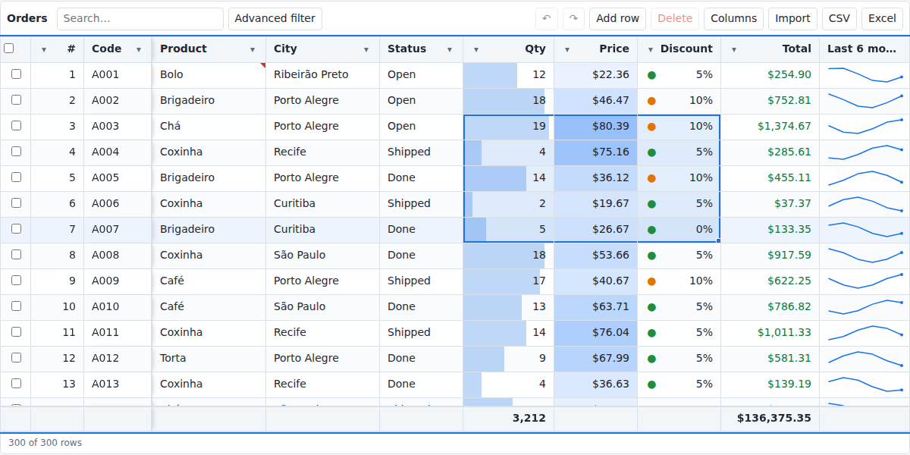
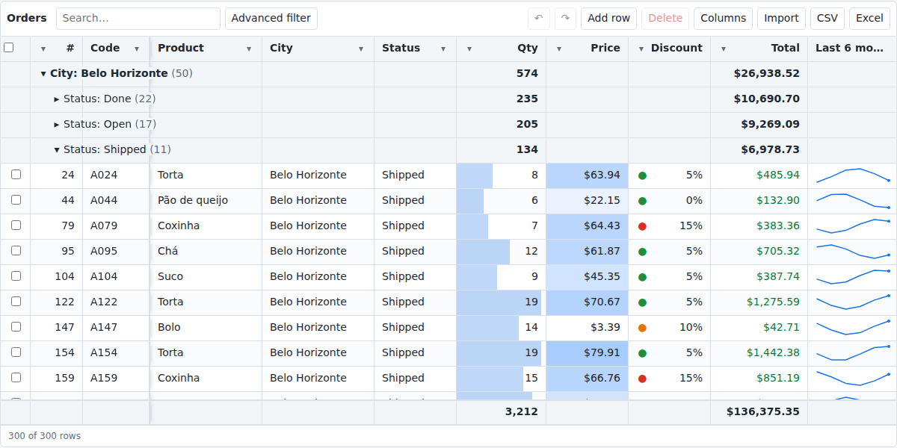
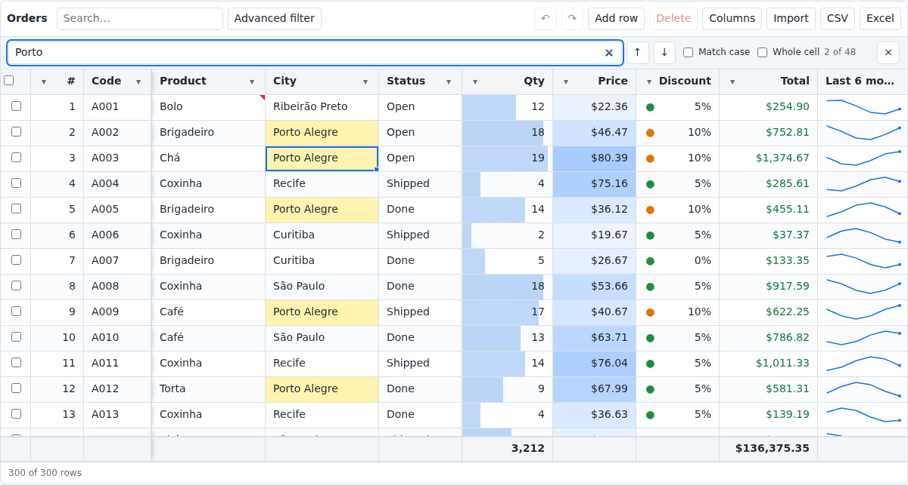
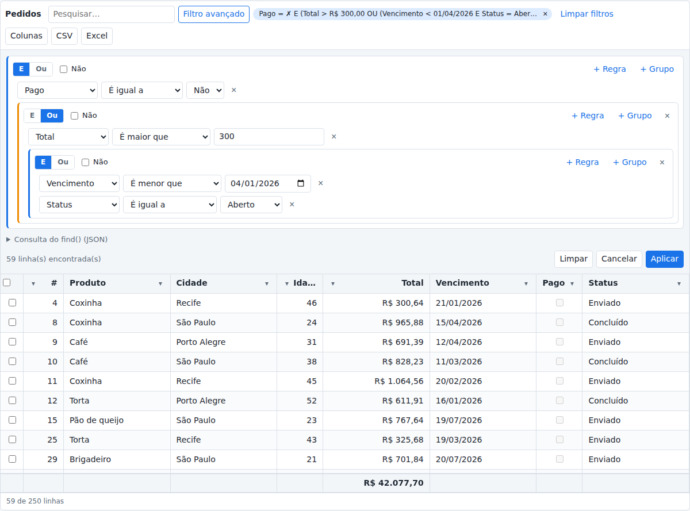
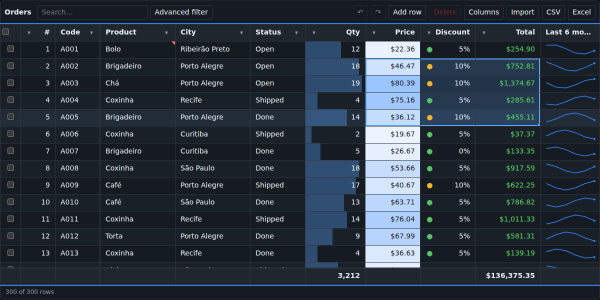
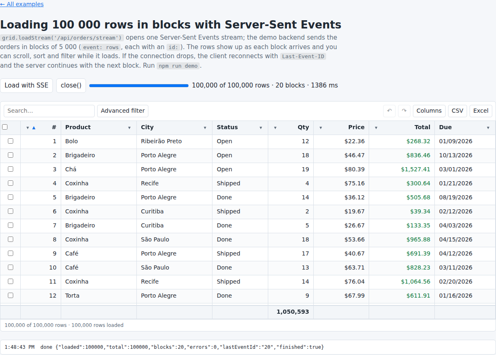
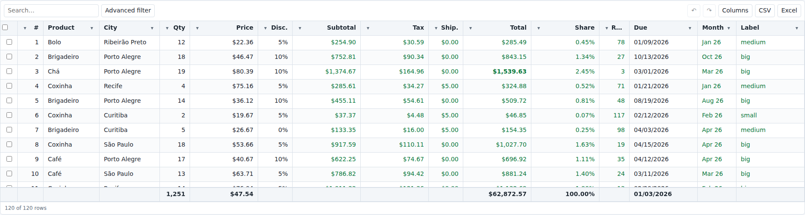

<div align="center">

# ▦ Intelligent Grid

### The Excel-like data grid for the browser.

**100 000 rows at 60 fps · 137 Excel functions · ranges, fill handle and undo · grouping with subtotals<br>
CSV & XLSX import and export · live data over WebSocket and Server-Sent Events · TypeScript · 56 kB gzip**

[](https://www.npmjs.com/package/@andmarruda/intelligent-grid)
[](LICENSE)
[](docs/benchmarks.md#bundle-size)
[](docs/typescript.md)
[](docs/development.md)

[**Documentation**](https://andmarruda.github.io/intelligent-grid/en/) ·
[**Documentação em português**](https://andmarruda.github.io/intelligent-grid/pt-BR/) ·
[**Live examples**](https://andmarruda.github.io/intelligent-grid/examples/) ·
[**React · Vue · Svelte · Angular**](#react-vue-svelte-and-angular) ·
[npm](https://www.npmjs.com/package/@andmarruda/intelligent-grid)



</div>

```bash
npm install @andmarruda/intelligent-grid sorla-db
```

```js
import { IntelligentGrid } from '@andmarruda/intelligent-grid';
import '@andmarruda/intelligent-grid/styles.css';
import sorla from 'sorla-db';

new IntelligentGrid('#orders', {
  sorla,
  idField: 'id',
  editable: true,
  data: await fetch('/api/orders').then(r => r.json()),
  columns: [
    { field: 'product', title: 'Product', validate: { required: true } },
    { field: 'qty', title: 'Qty', type: 'integer', footer: 'sum', conditionalFormats: [{ type: 'dataBar' }] },
    { field: 'price', title: 'Price', type: 'currency' },
    { field: 'total', title: 'Total', type: 'currency', formula: '=[@qty]*[@price]', footer: 'sum' }
  ]
});
```

That is a sortable, filterable, editable grid with a calculated column, totals, data bars, undo,
Excel copy and paste, CSV and XLSX export, and virtual scrolling. No other setup.

---

## Contents

- [Why Intelligent Grid](#why-intelligent-grid)
- [A tour in pictures](#a-tour-in-pictures)
- [Installation](#installation)
- [React, Vue, Svelte and Angular](#react-vue-svelte-and-angular)
- [Everything it does](#everything-it-does)
- [Performance](#performance)
- [Formulas](#formulas)
- [Data from your server](#data-from-your-server)
- [Keyboard](#keyboard)
- [API at a glance](#api-at-a-glance)
- [Events](#events)
- [Theming and languages](#theming-and-languages)
- [Examples](#examples)
- [Documentation](#documentation)
- [Development](#development)
- [License](#license)

## Why Intelligent Grid

| | |
|---|---|
| 🚀 **Fast with real data** | Rows and columns are virtualized: 100 000 rows open in under half a second and scroll at 60 fps, 1 000 000 rows still work. |
| 📊 **It is a spreadsheet** | Select ranges, paste blocks from Excel, drag the fill handle to continue a series, undo anything, find and replace, add comments. Your users already know how to use it. |
| 🧮 **Formulas, for real** | 137 Excel functions, calculated columns, per-cell formulas, totals, structured references (`=[@qty]*[@price]`), and XLSX export that keeps them as Excel formulas. |
| 🔎 **Filters people understand** | Excel's AutoFilter, a search box, and a visual query builder with nested AND / OR / NOT that produces MongoDB-style JSON your backend can run as is. |
| 🌐 **Live data** | Infinite scroll over `fetch` or a WebSocket, rows changed by other users pushed in place, and 100 000 rows streamed in blocks over Server-Sent Events. |
| ✅ **Built for forms and APIs** | Change tracking gives you inserted, updated and deleted rows as JSON, with a full history, accept and discard. |
| 🪶 **Small and dependency free** | 56 kB gzip for everything. Its only companion is [SorlaDB](https://sorladb.dev.br), the in-memory database it is built on. |
| 🧑‍💻 **Made for developers** | TypeScript types, events for everything, cancelable hooks, custom editors and renderers, CSS variables, English and Portuguese labels, and docs in both languages. |

## A tour in pictures

<table>
<tr>
<td width="50%"><br><b>Grouping with subtotals.</b> Group by one or more fields, collapse, and get a subtotal under every column.</td>
<td width="50%"><br><b>Find, replace and go to.</b> Ctrl+F, Ctrl+H and Ctrl+G, matches highlighted, replace all in one undo step.</td>
</tr>
<tr>
<td><br><b>Visual query builder.</b> Nested AND / OR / NOT groups that compile to a SorlaDB / MongoDB <code>find()</code> query.</td>
<td><br><b>Dark mode included.</b> Follows the system, or your own colors through CSS variables.</td>
</tr>
<tr>
<td><br><b>100 000 rows in 1.4 s</b> over Server-Sent Events, in blocks of 5 000, with progress, resuming after a dropped connection.</td>
<td><br><b>Formulas everywhere.</b> Calculated columns, cell formulas, lookups, dates, ranks, conditional formats and footers.</td>
</tr>
</table>

## Installation

### npm

```bash
npm install @andmarruda/intelligent-grid sorla-db   # sorla-db 1.7.1 or later
```

```js
import { IntelligentGrid } from '@andmarruda/intelligent-grid';   // ES module
import '@andmarruda/intelligent-grid/styles.css';                  // or styles.min.css
const { IntelligentGrid } = require('@andmarruda/intelligent-grid'); // CommonJS
```

Pass SorlaDB with the `sorla` option (`import sorla from 'sorla-db'`), or load its browser bundle and
the grid finds `window.sorla` by itself.

### A script tag, no build step

```html
<link rel="stylesheet" href="https://cdn.jsdelivr.net/npm/@andmarruda/intelligent-grid/dist/intelligent-grid.min.css">
<script src="https://cdn.jsdelivr.net/npm/sorla-db@1/dist/sorla.min.js"></script>
<script src="https://cdn.jsdelivr.net/npm/@andmarruda/intelligent-grid/dist/intelligent-grid.min.js"></script>

<div id="orders"></div>
<script>
  const grid = new IntelligentGrid('#orders', {
    columns: [{ field: 'name' }, { field: 'age', type: 'integer' }],
    data: [{ name: 'Ana', age: 31 }, { name: 'Bruno', age: 17 }]
  });
</script>
```

| File | For |
|---|---|
| `dist/index.js` | ES modules (Vite, webpack, esbuild, Rollup) |
| `dist/index.cjs` | CommonJS (`require`) |
| `dist/intelligent-grid.min.js` | a `<script>` tag: registers `window.IntelligentGrid` |
| `dist/intelligent-grid.css`, `.min.css` | the styles (required) |
| `dist/types` | TypeScript declarations (with maps to the sources) |

Works in every current browser. See [Getting started](docs/getting-started.md).

## React, Vue, Svelte and Angular

Native components for each framework live in
[**intelligent-grid-wrappers**](https://github.com/andmarruda/intelligent-grid-wrappers). They take every
option, forward every event and expose the grid instance.

| Framework | Package | |
|---|---|---|
| React 19+ | [`@andmarruda/intelligent-grid-react`](https://www.npmjs.com/package/@andmarruda/intelligent-grid-react) | `<IntelligentGrid columns={columns} data={rows} onCellChange={save} />` |
| Vue 3.5+ | [`@andmarruda/intelligent-grid-vue`](https://www.npmjs.com/package/@andmarruda/intelligent-grid-vue) | `<IntelligentGrid :columns="columns" :data="rows" @cell-change="save" />` |
| Svelte 5+ | [`@andmarruda/intelligent-grid-svelte`](https://www.npmjs.com/package/@andmarruda/intelligent-grid-svelte) | `<IntelligentGrid {columns} data={rows} onCellChange={save} />` |
| Angular 20+ | [`@andmarruda/intelligent-grid-angular`](https://www.npmjs.com/package/@andmarruda/intelligent-grid-angular) | `<intelligent-grid [columns]="columns" [data]="rows" (cellChange)="save($event)" />` |

```bash
npm install @andmarruda/intelligent-grid-react @andmarruda/intelligent-grid sorla-db
```

```tsx
import { IntelligentGrid } from '@andmarruda/intelligent-grid-react';
import '@andmarruda/intelligent-grid/styles.css';
import sorla from 'sorla-db';

<IntelligentGrid columns={columns} data={rows} options={{ sorla, idField: 'id', editable: true }}
    onCellChange={e => save(e.detail.row)} />
```

Full examples for all four: [React, Vue, Svelte and Angular](docs/frameworks.md).

## Everything it does

| Area | Features | Docs |
|---|---|---|
| **Data** | in-memory rows in a SorlaDB collection, 9 column types (text, number, integer, currency, percent, date, datetime, boolean, select), locale-aware parsing and formatting, Excel number formats | [Columns](docs/columns.md), [Number formats](docs/number-formats.md) |
| **Large data** | row and column virtualization, pinned (frozen) columns left and right, wrapped text with automatic row height | [Virtualization](docs/virtualization.md) |
| **Sorting** | multi-column, Excel order (blanks last, errors after values), locale collation | [Sorting & filtering](docs/sorting-filtering.md) |
| **Filtering** | Excel AutoFilter (value checklist + two conditions), global search, formula filters, filter chips, visual query builder with nested AND / OR / NOT | [Sorting & filtering](docs/sorting-filtering.md), [Advanced filter](docs/query-builder.md) |
| **Editing** | typed editors, validation rules, cancelable `beforeChange`, custom editors, Excel-style typing over a cell | [Editing](docs/editing.md) |
| **Spreadsheet** | cell ranges, copy / paste / clear blocks, fill handle with series, Ctrl+D / Ctrl+R, undo / redo, find / replace / go to, comments, remove duplicates | [Spreadsheet features](docs/spreadsheet.md) |
| **Formulas** | 137 functions, calculated columns, cell formulas, footers, custom functions, circular reference detection | [Formulas](docs/formulas.md), [Functions](docs/functions.md) |
| **Analysis** | grouping with collapsible rows and subtotals, data bars, color scales, icon sets, rule-based formats, sparklines | [Grouping](docs/grouping.md), [Formulas](docs/formulas.md#conditional-formats) |
| **Selection** | single or multiple rows, checkboxes, bulk actions in the navbar | [Selection](docs/selection.md) |
| **Import & export** | CSV / TSV and XLSX in both directions, formulas kept in XLSX, an Import button | [Export](docs/export.md), [Import](docs/import.md) |
| **Server data** | infinite scroll over `fetch` or WebSocket, rows pushed by the server, Server-Sent Events in blocks, filters sent as `find()` JSON | [Append mode](docs/append-mode.md), [Server data](docs/server-data.md) |
| **Change tracking** | inserted / updated / deleted rows, history, JSON for a form, accept / discard, confirmation modal | [Change tracking](docs/change-tracking.md) |
| **UI** | navbar with your own buttons, status bar, dark mode, CSS variables, English and Portuguese labels | [Navbar](docs/navbar.md), [Theming](docs/theming.md), [i18n](docs/i18n.md) |

## Performance

Measured in Chromium with `npm run bench` (laptop, 4 cores). The scenario has 12 columns, a
calculated column and a column that depends on every row (`=[@total]/SUM([total])`).

| rows | open | filter | sort | edit + recalc | scroll frame | DOM rows | memory |
|---|---|---|---|---|---|---|---|
| 10 000 | 85 ms | 33 ms | 34 ms | 33 ms | 16.7 ms (60 fps) | 27 | 10 MB |
| 100 000 | 447 ms | 58 ms | 250 ms | 200 ms | 16.7 ms (60 fps) | 27 | 96 MB |

The DOM always holds about 30 rows, whatever the size. Formulas compute whole-column
sub-expressions like `SUM([total])` once per recalculation instead of once per row. Details in
[Benchmarks](docs/benchmarks.md).

## Formulas

```js
columns: [
  { field: 'qty', type: 'integer' },
  { field: 'price', type: 'currency' },
  { field: 'total', type: 'currency', formula: '=[@qty]*[@price]', footer: 'sum' },
  { field: 'share', type: 'percent', formula: '=[@total]/SUM([total])' },
  { field: 'status', formula: '=IF([@total]>1000,"VIP",IF([@total]>100,"Regular","Small"))' },
  { field: 'due', type: 'date' },
  { field: 'late', type: 'boolean', formula: '=AND(NOT([@paid]),[@due]<TODAY())' }
]
```

- **Structured references:** `[@field]` is this row, `[field]` the whole column, and named constants
  (`names: { TAX: 0.12 }`).
- **137 functions** in math, statistics, text, dates, logic and lookup: `SUM`, `SUMIFS`, `AVERAGEIFS`,
  `COUNTIFS`, `XLOOKUP`, `INDEX` / `MATCH`, `IFS`, `SWITCH`, `TEXT`, `DATEDIF`, `NETWORKDAYS`,
  `EOMONTH`, `ROUND`, `MEDIAN`, `PERCENTILE`, `RANK`… [The full list](docs/functions.md).
- **Cell formulas:** users can type `=…` in any editable cell.
- **Your own functions:** `IntelligentGrid.defineFunction('VAT', ([amount]) => amount * 0.2)`.
- **XLSX keeps them:** exported files contain real Excel formulas, not just values.

```js
grid.evaluate('=SUMIFS([total],[city],"Recife")');   // ad-hoc, over the filtered rows
```

## Data from your server

Three ways, all keeping the rows already loaded and all optional: `setData(rows)` works too.

**Pages over `fetch`** ([append mode](docs/append-mode.md)): the grid asks for the next page as the
user scrolls, and sends sort, filters and search. `where` is one MongoDB-style query your server can
run as is.

```js
append: {
  pageSize: 100,
  load: ({ offset, limit, sort, where, search }) =>
    fetch(`/api/orders?${new URLSearchParams({ offset, limit, sort: JSON.stringify(sort), where: JSON.stringify(where), search })}`)
      .then(r => r.json())   // { rows, hasMore, total }
}
```

**A WebSocket**: the same pages over one connection, plus rows other users change, pushed in place.

```js
append: { pageSize: 100, socket: sorla.connect('wss://api.example.com/orders') }
```

**Server-Sent Events**: everything, in blocks, with progress, resuming after a dropped connection.

```js
const stream = grid.loadStream('/api/orders/stream', { onProgress: ({ loaded, total }) => bar.value = loaded / total });
await stream.done;
```

Rows that come from the server never count as unsaved changes, and a field the user is editing keeps
the user's value. See [Server data](docs/server-data.md), and run the three demos with `npm run demo`.

## Keyboard

| Action | Keys |
|---|---|
| Move | arrows, Tab, Enter; Ctrl + arrow jumps to the edge |
| Select a range | Shift + arrows, Shift + click, drag; Ctrl + A for everything |
| Edit | type over a cell, F2 or double click; Esc cancels |
| Copy, paste, clear | Ctrl + C, Ctrl + V (from Excel too), Delete |
| Fill | drag the handle, double click it, Ctrl + D, Ctrl + R |
| Undo, redo | Ctrl + Z, Ctrl + Y |
| Find, replace, go to | Ctrl + F, Ctrl + H, Ctrl + G |
| Comment | Shift + F2 |

## API at a glance

```js
// data
grid.setData(rows);  grid.addRow({ … });  grid.addRows(rows);  grid.updateRow(id, patch);  grid.deleteRows(ids);
grid.getRows('filtered');  grid.getRow(id);  grid.setCellValue(id, 'qty', 3);
// sort and filter
grid.setSort([{ field: 'total', dir: 'desc' }]);
grid.setFilter('city', { values: ['Recife', 'Natal'] });
grid.setSearch('café');
grid.fromSorlaQuery({ $or: [{ total: { $gt: 1000 } }, { vip: true }] });
// spreadsheet
grid.setRange({ id: '1', field: 'qty' }, { id: '5', field: 'price' });  grid.fill('down', 10);
grid.undo();  grid.redo();  grid.find('café');  grid.replace('Cafe', 'Café');  grid.goTo('120 Price');
// analysis
grid.setGroupBy(['region', 'city']);  grid.pinColumn('id', 'left');
// import, export, server
await grid.importFile(file);  grid.exportXLSX();  grid.exportCSV();
grid.loadStream('/api/orders/stream');  grid.applyServerChanges({ rows, ids });
// changes for your form or API
grid.getChanges();   // { inserted: [...], updated: [...], deleted: [...] }
grid.bindForm(form); // a hidden input with the JSON, always current
```

Every method: [API reference](docs/api.md).

## Events

```js
grid.on('cellChange', e => api.save(e.detail.row));
grid.on('beforeCellChange', e => { if (e.detail.value < 0) e.preventDefault(); });   // cancelable
grid.on('selectionChange', e => toolbar.update(e.detail.ids));
grid.on('changes', e => saveButton.disabled = !e.detail.hasChanges);
```

More than 40 events, from `render` and `sortChange` to `fill`, `groupToggle` and `serverChange`. See
[Events](docs/events.md).

## Theming and languages

```css
.ig { --ig-accent: #7c3aed; --ig-row-height: 30px; --ig-font: 'Inter', sans-serif; }
```

Every color, size and font is a CSS variable, and dark mode follows `prefers-color-scheme`. Numbers,
dates and typed input follow the `locale` (`1.234,56` in `pt-BR`, `1,234.56` in `en-US`), and the
labels ship in English and Portuguese; override any of them with `labels`. See
[Theming](docs/theming.md) and [Internationalization](docs/i18n.md).

## Examples

Try them online at **[andmarruda.github.io/intelligent-grid/examples](https://andmarruda.github.io/intelligent-grid/examples/)**,
or locally:

```bash
git clone https://github.com/andmarruda/intelligent-grid.git && cd intelligent-grid
npm install
npm run demo        # http://localhost:5173/examples/
```

| Example | Shows |
|---|---|
| [spreadsheet.html](examples/spreadsheet.html) | Ranges, fill handle, undo, find / replace, grouping, data bars, sparklines, comments, import, 100 000 rows |
| [basic.html](examples/basic.html) | Columns, types, data and the default navbar |
| [sorting-filtering.html](examples/sorting-filtering.html) | Multi-column sort, AutoFilter, search, formula filters |
| [query-builder.html](examples/query-builder.html) | Advanced filter: nested AND / OR / NOT, live find() JSON, run it directly in SorlaDB |
| [editing.html](examples/editing.html) | Editors, validation, cancelable events, a custom editor, paste |
| [formulas.html](examples/formulas.html) | Calculated columns, cell formulas, footers, conditional formats, custom functions |
| [change-tracking.html](examples/change-tracking.html) | Inserted/updated/deleted rows, history, saving with a form, accept/discard |
| [selection-export.html](examples/selection-export.html) | Single/multiple selection, bulk actions, CSV and XLSX |
| [theming-i18n.html](examples/theming-i18n.html) | CSS variables, dark mode, en-US vs pt-BR |
| [infinite-scroll.html](examples/infinite-scroll.html) | Append mode with a fake paginated API |
| [fetch-pages.html](examples/fetch-pages.html) ¹ | Pages over HTTP from the demo backend, filters sent as `find()` JSON |
| [websocket.html](examples/websocket.html) ¹ | Infinite scroll over a WebSocket, rows changed by another user pushed in place |
| [sse-stream.html](examples/sse-stream.html) ¹ | 100 000 rows over Server-Sent Events in blocks of 5 000 |
| [browser-bundle.html](examples/browser-bundle.html) | Classic `<script>` tags with `window.IntelligentGrid` |

¹ These talk to the demo backend in [`scripts/demo-api.ts`](scripts/demo-api.ts) (100 000 orders in a
SorlaDB collection on the server), so they need `npm run demo`.

> Open the examples through `npm run demo`, not as `file://` pages: browsers block ES modules and the
> `node_modules/` paths outside a server.

**Your own data:** the examples use [`examples/data.js`](examples/data.js) (`orders(count)`,
`customers(count)`); replace `data:` with your array, keys matching the columns' `field` and dates as
ISO strings, or `await fetch('./my-data.json').then(r => r.json())`.

**The console is your playground:** every example exposes the grid as `window.grid`. Open the devtools
(F12) and try `grid.getRows('filtered')`, `grid.setGroupBy(['city'])`, `grid.evaluate('=SUM([qty])')`
or `grid.exportXLSX()`.

## Documentation

The full documentation is on **[the website](https://andmarruda.github.io/intelligent-grid/)**, in
English and Portuguese, and in [`docs/`](docs/README.md) ([pt-BR](docs/pt-BR/README.md)).

| Start | Features | Formulas | Reference | Project |
|---|---|---|---|---|
| [Getting started](docs/getting-started.md) · [Frameworks](docs/frameworks.md) | [Sorting & filtering](docs/sorting-filtering.md) | [Formulas](docs/formulas.md) | [API](docs/api.md) | [Architecture](docs/architecture.md) |
| [Options](docs/options.md) | [Advanced filter](docs/query-builder.md) | [137 functions](docs/functions.md) | [Events](docs/events.md) | [Benchmarks](docs/benchmarks.md) |
| [Columns](docs/columns.md) | [Editing](docs/editing.md) | [Number formats](docs/number-formats.md) | [TypeScript](docs/typescript.md) | [SorlaDB status](docs/sorla-db.md) |
| | [Spreadsheet](docs/spreadsheet.md) · [Grouping](docs/grouping.md) | | [Theming](docs/theming.md) | [Development](docs/development.md) |
| | [Selection](docs/selection.md) · [Navbar](docs/navbar.md) | | [i18n](docs/i18n.md) | |
| | [Virtualization](docs/virtualization.md) · [Import](docs/import.md) · [Export](docs/export.md) | | | |
| | [Append mode](docs/append-mode.md) · [Server data](docs/server-data.md) · [Change tracking](docs/change-tracking.md) | | | |

## Development

```bash
npm install          # also installs the git hooks
npm run check        # lint + typecheck + 130 unit tests + build (with a 64 kB gzip budget)
npm run test:e2e     # 17 Playwright tests in a real browser
npm run bench        # timings for 10 000 and 100 000 rows
npm run screenshots  # the images of this README
npm run site         # the documentation website, in site/
```

Every commit runs lint, the type check and the build; every push runs the tests. Contributions are
welcome: see [Development](docs/development.md).

## License

[MIT](LICENSE) © Anderson Arruda
